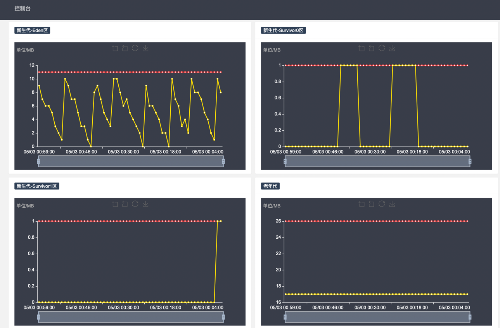
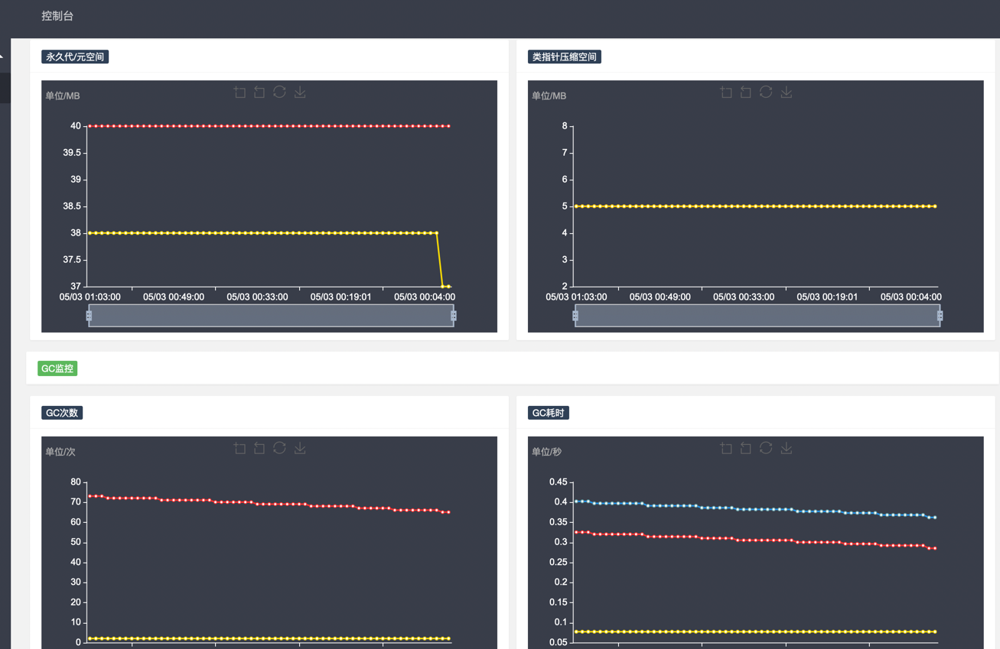
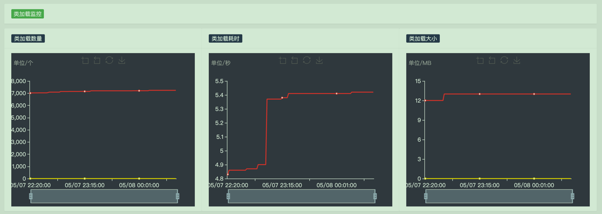

# JVM监控平台 Agent-Monitor

#### 介绍
本人在借鉴多个优质的开源项目当中，把自己看到的学到的都分享出来，从而开发出一个监测平台
jvm探针监控+可视化，用来监控JVM或操作系统，因为是Java开发的 所以，可以作为jar包依赖到JAVA项目当中，
也可以单独部署.jar

#### 软件架构
1. Jvm-Agent 探针 可以集成到JAVA项目也可以单独部署到服务器中 
2. Jvm-Monitor 可视化平台 需要先执行actuator.sql脚本文件，然后在启动该项目 
3. 注意 数据库的platform表，需要配置你监控的多个Agent地址或一个
#### 安装使用
1. 使用maven打包Jvm-Agent项目，然后运行jar或maven集成到其他项目当中

    <dependency>
      <groupId>com.langjn.agent</groupId>
      <artifactId>Jvm-Agent</artifactId>
      <version>2.0</version>
    </dependency>
2. 集成到maven中的时候需要设置白名单 monitor.server.ip= 
3. 执行monitor.sql脚本，配置platform表 name字段是Agent所属项目名称
4. 启动Jvm-Monitor平台 访问 http://127.0.0.1:8080/index

#### 统计描述：
4. 操作系统整体负载情况
5. 操作系统内存空间(总/已用/可用）虚拟内存页(放入/放出/page大小)
6. 磁盘空间(总/已用/可用）CPU (核/温度/电压/风扇转速)  
7. 新生代 eden区空间（总/可用） s0区空间（总/可用） s1区空间（总/可用） 
8. 老年代空间（总/可用） 
9. 元空间空间（总/可用） 
10. 类指针压缩空间（总/可用） 
11. YGC次数、FGC次数、GC耗时 
12. 类加载数量（成功/失败） 类加载耗时、类加载大小、类编译数量、类编译耗时、 
13. 线程状态数量(总数/运行/等待/休眠)
#### 统计图展示如下：

