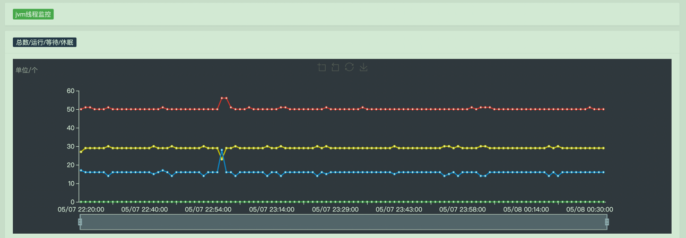

<div align="center">

```
      ___      ____  __   __  __             _ _
     | \ \    / /  \/  | |  \/  |           (_) |
     | |\ \  / /| \  / | | \  / | ___  _ __  _| |_ ___  _ __
 _   | | \ \/ / | |\/| | | |\/| |/ _ \| '_ \| | __/ _ \| '__|
| |__| |  \  /  | |  | | | |  | | (_) | | | | | || (_) | |
 \____/    \/   |_|  |_| |_|  |_|\___/|_| |_|_|\__\___/|_|
```

**Agent 探针采集 + Monitor 可视化，一站式 JVM / 操作系统监控平台**

[](https://www.oracle.com/java/)
[](https://spring.io/projects/spring-boot)
[](https://maven.apache.org/)
[](https://baomidou.com/)
[](https://www.mysql.com/)
[](https://github.com/oshi/oshi)
[](https://www.quartz-scheduler.org/)
[](https://www.thymeleaf.org/)
[](https://spring.io/guides/gs/messaging-stomp-websocket/)
[](https://v2.vuejs.org/)
[](https://echarts.apache.org/)
[](https://layui.dev/)
[](https://getbootstrap.com/)
[](LICENSE)

</div>

---

## 📖 项目介绍

**Jvm-Agent-Monitor** 是一个借鉴多个优秀开源项目思想、自主开发的 JVM 探针监控 + 可视化平台，用于实时监控 JVM 运行状态与操作系统指标。

由于探针本身由 Java 开发，因此：

- 可作为 **Maven 依赖** 无缝集成到任意 Java 项目中；
- 也可打包为 **独立 jar** 部署在任意服务器上运行。

采集数据通过 HTTP 上报至 Monitor 平台，经 WebSocket 实时推送，最终在可视化大屏中呈现。

## 🏗️ 软件架构

```
┌──────────────────┐   HTTP 上报    ┌──────────────────┐   WebSocket    ┌──────────────────┐
│     Jvm-Agent    │ ─────────────► │    Jvm-Monitor   │ ─────────────► │     浏览器大屏     │
│  探针(嵌入式/独立) │                │ 采集/存储/推送服务  │                │  ECharts 实时可视化 │
└──────────────────┘                └────────┬─────────┘                └──────────────────┘
                                             │
                                     ┌───────▼────────┐
                                     │      MySQL      │
                                     │  platform / 指标 │
                                     └────────────────┘
```

| 模块 | 说明 |
| --- | --- |
| **Jvm-Agent** | 探针模块。基于 OSHI + JMX 采集 JVM 与系统指标，可集成到 Java 项目，也可单独部署 |
| **Jvm-Monitor** | 可视化平台。负责接收上报数据、持久化存储与实时展示。启动前需执行 `monitor.sql` |
| **monitor.sql** | 数据库脚本。`platform` 表需配置被监控 Agent 的地址（一个或多个），`name` 字段为 Agent 所属项目名称 |

## 🧰 技术栈

### 后端

| 技术 | 版本 | 用途 |
| --- | --- | --- |
| Java | 1.8 | 开发语言 |
| Spring Boot | 2.x | 应用框架（Web / AOP / WebSocket） |
| OSHI Core | 3.9.1 | 操作系统硬件信息采集（CPU / 内存 / 磁盘 / 温度） |
| JMX | - | JVM 运行时指标采集（GC / 线程 / 类加载 / 内存池） |
| MyBatis-Plus | 3.0.6 | ORM 持久层 |
| MySQL | 5.7+ | 数据存储 |
| Quartz | - | 定时任务调度 |
| Thymeleaf | - | 服务端模板渲染 |
| HttpClient / Gson / FastJSON | - | 数据上报与序列化 |

### 前端

| 技术 | 用途 |
| --- | --- |
| Vue.js | 页面交互 |
| ECharts | 监控图表可视化 |
| LayUI + Bootstrap | UI 框架 |
| SockJS + STOMP | WebSocket 实时通信 |

## 📊 监控指标

### 🖥️ 操作系统
- 系统整体负载情况
- 物理内存（总量 / 已用 / 可用）、虚拟内存页（放入 / 放出 / 页大小）
- 磁盘空间（总量 / 已用 / 可用）
- CPU（核心数 / 温度 / 电压 / 风扇转速）

### ☕ JVM
- 新生代：Eden 区、Survivor S0 / S1 区（总量 / 可用）
- 老年代（总量 / 可用）
- 元空间 Metaspace（总量 / 可用）
- 类指针压缩空间（总量 / 可用）
- GC 统计：YGC 次数、FGC 次数、GC 耗时
- 类加载：加载数量（成功 / 失败）、加载耗时、加载大小、编译数量、编译耗时
- 线程状态：总数 / 运行 / 等待 / 休眠

## 🚀 快速开始

### 1. 部署 Agent 探针

**方式一：Maven 依赖集成**

```xml
<dependency>
    <groupId>com.langjn.agent</groupId>
    <artifactId>Jvm-Agent</artifactId>
    <version>2.0</version>
</dependency>
```

集成时需配置上报白名单：

```properties
monitor.server.ip=<Monitor平台地址>
```

**方式二：独立部署**

```bash
# 使用 Maven 打包
mvn clean package -DskipTests

# 运行独立探针 jar
java -jar Jvm-Agent-2.1-execute.jar
```

### 2. 初始化数据库

```bash
mysql -u root -p < monitor.sql
```

配置 `platform` 表，填写被监控 Agent 的地址与项目名称。

### 3. 启动 Monitor 平台

```bash
cd Jvm-Monitor
mvn spring-boot:run
```

浏览器访问 👉 **http://127.0.0.1:8080/index**

## 🖼️ 效果展示

|  |  |
| --- | --- |
|  |  |
|  |  |
|  |  |
|  |  |

## 📄 License

本项目基于 [MIT License](LICENSE) 开源，欢迎学习、使用与贡献。

---

<div align="center">

如果这个项目对你有帮助，欢迎点个 **Star** ⭐ 支持一下！

</div>
