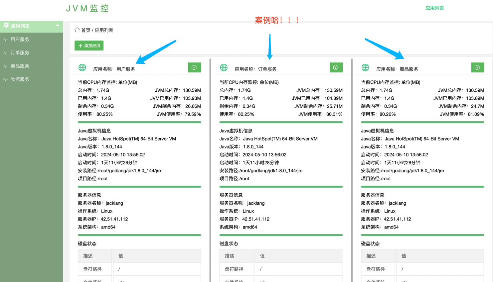
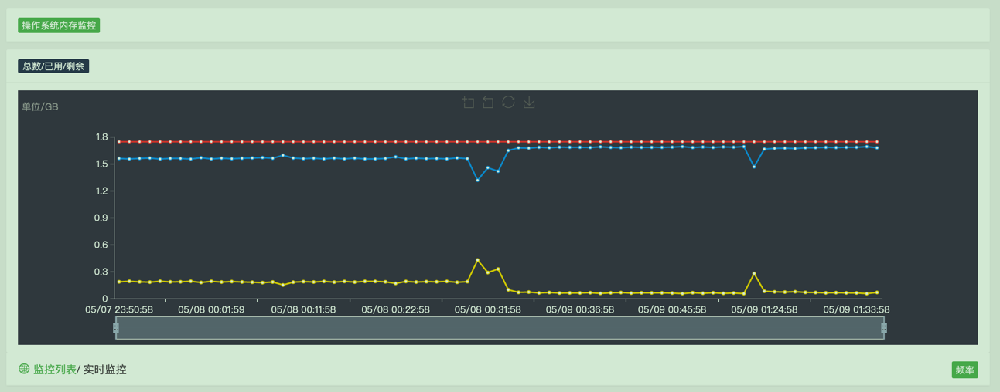
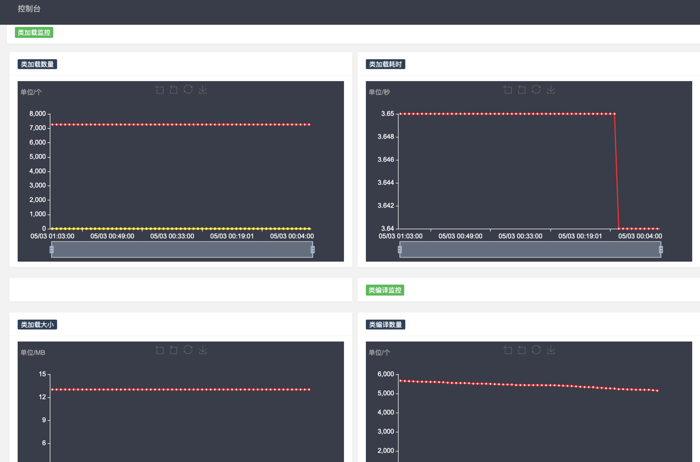
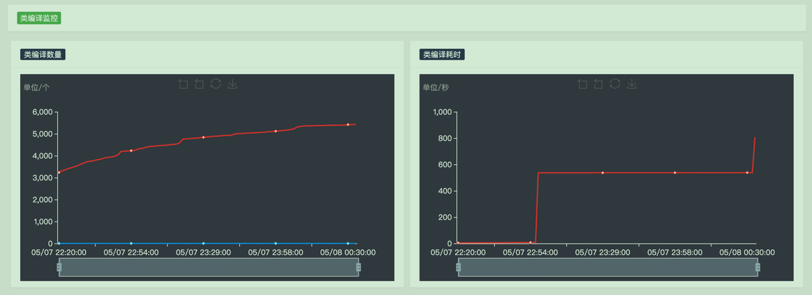

<div align="center">

```
     ██╗██╗   ██╗███╗   ███╗    ███╗   ███╗ ██████╗ ███╗   ██╗██╗████████╗ ██████╗ ██████╗ 
     ██║██║   ██║████╗ ████║    ████╗ ████║██╔═══██╗████╗  ██║██║╚══██╔══╝██╔═══██╗██╔══██╗
     ██║██║   ██║██╔████╔██║    ██╔████╔██║██║   ██║██╔██╗ ██║██║   ██║   ██║   ██║██████╔╝
██   ██║╚██╗ ██╔╝██║╚██╔╝██║    ██║╚██╔╝██║██║   ██║██║╚██╗██║██║   ██║   ██║   ██║██╔══██╗
╚█████╔╝ ╚████╔╝ ██║ ╚═╝ ██║    ██║ ╚═╝ ██║╚██████╔╝██║ ╚████║██║   ██║   ╚██████╔╝██║  ██║
 ╚════╝   ╚═══╝  ╚═╝     ╚═╝    ╚═╝     ╚═╝ ╚═════╝ ╚═╝  ╚═══╝╚═╝   ╚═╝    ╚═════╝ ╚═╝  ╚═╝
```

**轻若无形 · 察于未萌 —— 企业级 JVM 全链路可观测性平台**

一针探针，洞察虚拟机每一次呼吸；一方大屏，掌控集群每一寸资源。

[](https://www.oracle.com/java/)
[](https://spring.io/projects/spring-boot)
[](https://maven.apache.org/)
[](https://baomidou.com/)
[](https://www.mysql.com/)
[](https://github.com/oshi/oshi)
[](https://www.quartz-scheduler.org/)
[](https://www.thymeleaf.org/)
[](https://spring.io/guides/gs/messaging-stomp-websocket/)
[](https://v2.vuejs.org/)
[](https://echarts.apache.org/)
[](https://layui.dev/)
[](https://getbootstrap.com/)
[](LICENSE)

</div>

---

## 🌟 项目简介

🚩🎌🏴 **快速认识 Jvm-Agent-Monitor** 🏴🎌🚩

> 🎯 **一句话定位**：一针探针 💉，洞察虚拟机每一次呼吸；一方大屏 🖥️，掌控集群每一寸资源。

⚡ **为什么选择我们？**

| 🏅 | 🔥 核心能力 | 💡 你得到的价值 |
|:---:|:---|:---|
| 🚀 | **零侵入接入** | 一行 Maven 依赖或一个 jar 包，即刻上线 |
| 🔍 | **全链路采集** | 从 CPU 温度到 GC 停顿，指标一网打尽 |
| 📡 | **毫秒级推送** | WebSocket 实时刷新，数据永不撒谎 |
| 🛡️ | **安全白名单** | IP 白名单管控，上报通道固若金汤 |
| 📊 | **可视化大屏** | ECharts 动态图表，态势一屏尽览 |
| ⏱️ | **智能调度** | Quartz 定时巡检，异常无处遁形 |

🚩 **监控版图全景**

- 🖥️ **操作系统** —— 🚩 系统负载｜💽 内存版图｜🗄️ 磁盘空间｜🔥 CPU 温度·电压·风扇
- ☕ **JVM 运行时** —— 🚩 新生代 Eden/S0/S1｜🚩 老年代｜🚩 元空间｜🚩 GC 脉搏（YGC/FGC/耗时）
- 🧬 **深度洞察** —— 🏴 类加载数量与耗时｜🏴 线程状态四象限｜🏴 压缩类指针空间

## 📖 项目介绍

> 当一次悄无声息的 Full GC 拖垮线上服务，当内存泄漏在深夜慢慢吞噬堆空间——你需要的不是事后复盘，而是**此刻可见**。

**Jvm-Agent-Monitor** 是一套自主设计研发的 **JVM 探针采集 + 实时可视化** 监控平台，覆盖从操作系统硬件到虚拟机运行时的完整指标链路，让每一次 GC 停顿、每一字节内存波动、每一个线程状态迁移都尽收眼底。

探针以纯 Java 实现，践行**零侵入、双形态**的接入哲学：

- 🔩 **嵌入式** —— 一行 Maven 依赖，即刻融入任意 Java 应用；
- 🚀 **独立式** —— 单个 jar 包，即可守护任意服务器。

采集数据经 HTTP 上报至 Monitor 中枢，持久化沉淀至 MySQL，再通过 WebSocket 毫秒级推送至可视化大屏——**从堆内存到物理磁盘，全局态势一屏尽览**。

## 🏗️ 软件架构

```
┌──────────────────┐   HTTP 上报    ┌──────────────────┐   WebSocket    ┌──────────────────┐
│     Jvm-Agent    │ ─────────────► │    Jvm-Monitor   │ ─────────────► │     浏览器大屏     │
│  探针(嵌入式/独立) │                │ 采集/存储/推送服务  │                │  ECharts 实时可视化 │
└──────────────────┘                └────────┬─────────┘                └──────────────────┘
                                             │
                                     ┌───────▼────────┐
                                     │      MySQL      │
                                     │  platform / 指标 │
                                     └────────────────┘
```

| 模块 | 说明 |
| --- | --- |
| **Jvm-Agent** | 探针模块。基于 OSHI + JMX 双引擎采集 JVM 与系统指标，可集成到 Java 项目，也可单独部署 |
| **Jvm-Monitor** | 可视化中枢。负责数据接收、持久化存储与实时推送。启动前需执行 `monitor.sql` |
| **monitor.sql** | 数据库脚本。`platform` 表配置被监控 Agent 的地址（支持一对多），`name` 字段为 Agent 所属项目名称 |

## 🧰 技术栈

### 后端

| 技术 | 版本 | 用途 |
| --- | --- | --- |
| Java | 1.8 | 开发语言 |
| Maven | 3.x | 项目构建与依赖管理 |
| Spring Boot | 2.x | 应用框架（Web / AOP / WebSocket） |
| OSHI Core | 3.9.1 | 操作系统硬件信息采集（CPU / 内存 / 磁盘 / 温度） |
| JMX | - | JVM 运行时指标采集（GC / 线程 / 类加载 / 内存池） |
| MyBatis-Plus | 3.0.6 | ORM 持久层 |
| MySQL | 5.7+ | 数据存储 |
| Quartz | - | 定时任务调度 |
| Thymeleaf | - | 服务端模板渲染 |
| HttpClient / Gson / FastJSON | - | 数据上报与序列化 |

### 前端

| 技术 | 用途 |
| --- | --- |
| Vue.js | 页面交互 |
| ECharts | 监控图表可视化 |
| LayUI + Bootstrap | UI 框架 |
| SockJS + STOMP | WebSocket 实时通信 |

### 🚩 技术旗帜墙 · 全部点亮

<div align="center">

**🎌 后端军团 🎌**

[](https://www.oracle.com/java/)
[](https://spring.io/projects/spring-boot)
[](https://spring.io/projects/spring-framework)
[](https://maven.apache.org/)
[](https://baomidou.com/)
[](https://www.mysql.com/)
[](https://github.com/oshi/oshi)
[](https://docs.oracle.com/javase/8/docs/technotes/guides/jmx/)
[](https://www.quartz-scheduler.org/)
[](https://www.thymeleaf.org/)
[](https://github.com/alibaba/fastjson)
[](https://github.com/google/gson)
[](https://hc.apache.org/)

**🎌 前端军团 🎌**

[](https://v2.vuejs.org/)
[](https://echarts.apache.org/)
[](https://layui.dev/)
[](https://getbootstrap.com/)
[](https://jquery.com/)
[](https://spring.io/guides/gs/messaging-stomp-websocket/)
[](https://github.com/sockjs/sockjs-client)

</div>

## 📊 监控指标

### 🖥️ 操作系统 · 硬件透视

- **负载态势** —— 系统整体负载情况，一眼辨识资源瓶颈
- **内存版图** —— 物理内存（总量 / 已用 / 可用）、虚拟内存页（调入 / 调出 / 页大小）
- **存储与算力** —— 磁盘空间（总量 / 已用 / 可用）、CPU（核心数 / 温度 / 电压 / 风扇转速）

### ☕ JVM · 运行时全景

- **内存池** —— 新生代 Eden / Survivor S0 / S1、老年代、元空间 Metaspace、类指针压缩空间（总量 / 可用）
- **GC 脉搏** —— YGC 次数、FGC 次数、GC 耗时，捕捉每一次停顿
- **类加载** —— 加载数量（成功 / 失败）、加载耗时、加载大小、编译数量、编译耗时
- **线程态势** —— 总数 / 运行 / 等待 / 休眠，线程健康尽收眼底

## 🚀 快速开始

### 1. 部署 Agent 探针

**方式一：Maven 依赖集成**

```xml
<dependency>
    <groupId>com.langjn.agent</groupId>
    <artifactId>Jvm-Agent</artifactId>
    <version>2.0</version>
</dependency>
```

集成时需配置上报白名单：

```properties
monitor.server.ip=<Monitor平台地址>
```

**方式二：独立部署**

```bash
# 使用 Maven 打包
mvn clean package -DskipTests

# 运行独立探针 jar
java -jar Jvm-Agent-2.1-execute.jar
```

### 2. 初始化数据库

```bash
mysql -u root -p < monitor.sql
```

配置 `platform` 表，填写被监控 Agent 的地址与项目名称。

### 3. 启动 Monitor 平台

```bash
cd Jvm-Monitor
mvn spring-boot:run
```

浏览器访问 👉 **http://127.0.0.1:8080/index**

## 🖼️ 效果展示

<table>
<tr><td align="center"><b>监控总览大屏</b></td></tr>
<tr><td align="center"></td></tr>
<tr><td align="center"><b>操作系统指标</b></td></tr>
<tr><td align="center"></td></tr>
<tr><td align="center"><b>内存空间分析</b></td></tr>
<tr><td align="center"></td></tr>
<tr><td align="center"><b>新生代 / 老年代监控</b></td></tr>
<tr><td align="center"></td></tr>
<tr><td align="center"><b>元空间与类指针压缩</b></td></tr>
<tr><td align="center"></td></tr>
<tr><td align="center"><b>GC 统计追踪</b></td></tr>
<tr><td align="center"></td></tr>
<tr><td align="center"><b>类加载监控</b></td></tr>
<tr><td align="center"></td></tr>
<tr><td align="center"><b>线程状态分析</b></td></tr>
<tr><td align="center"></td></tr>
</table>

## 📄 License

本项目基于 [MIT License](LICENSE) 开源，欢迎学习、使用与贡献。

---

<div align="center">

如果这个项目为你洞察了每一次 GC 的脉动，欢迎点亮一颗 **Star** ⭐ —— 这是对本项目最大的鼓励！

</div>
